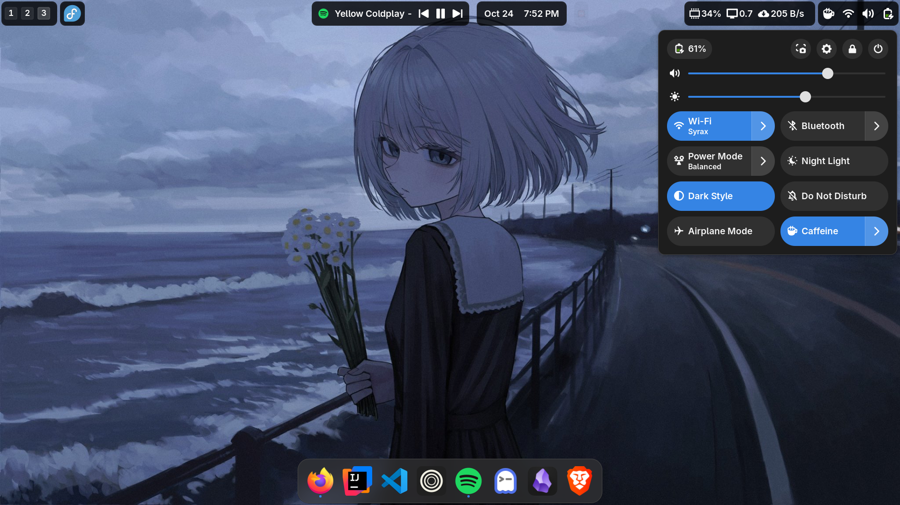
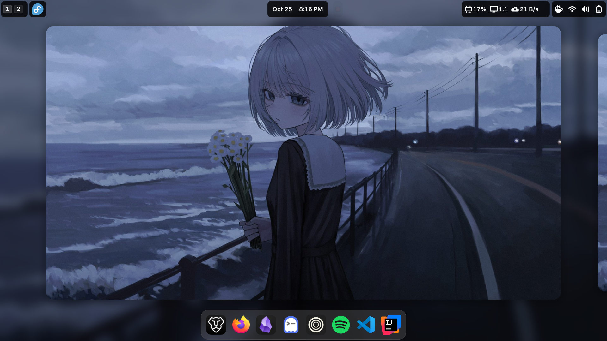
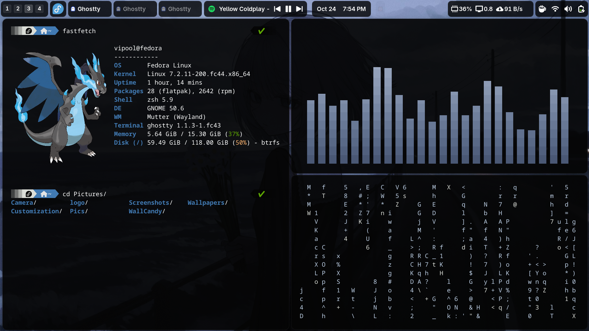
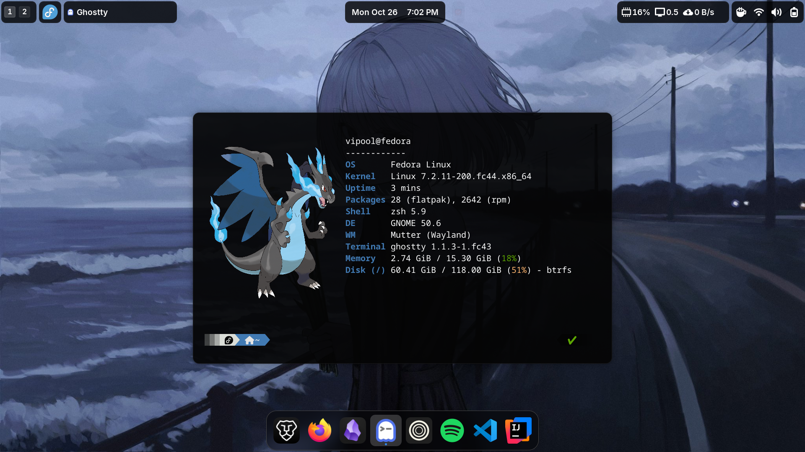
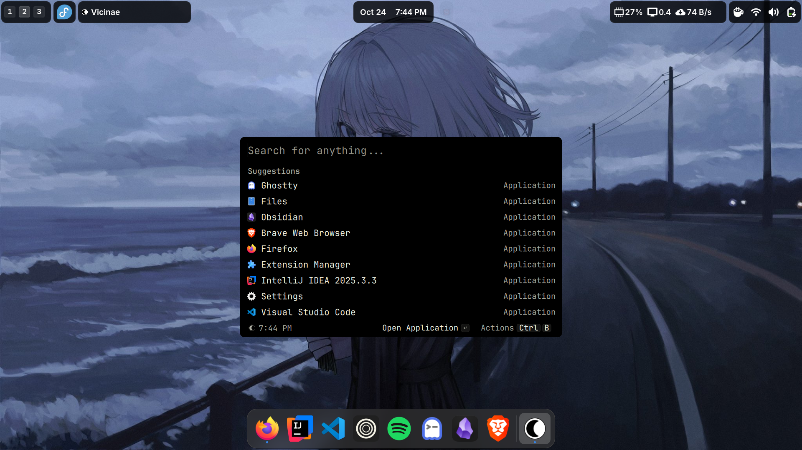
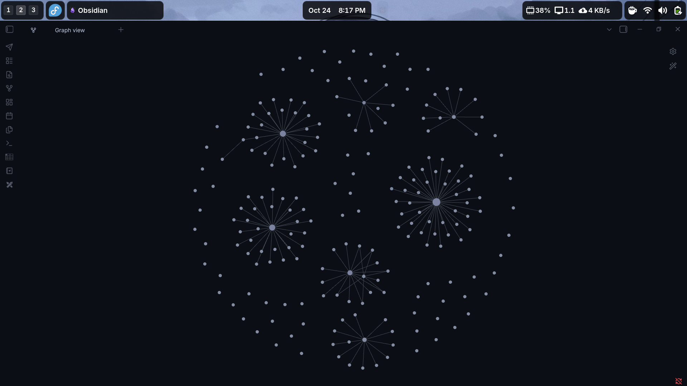
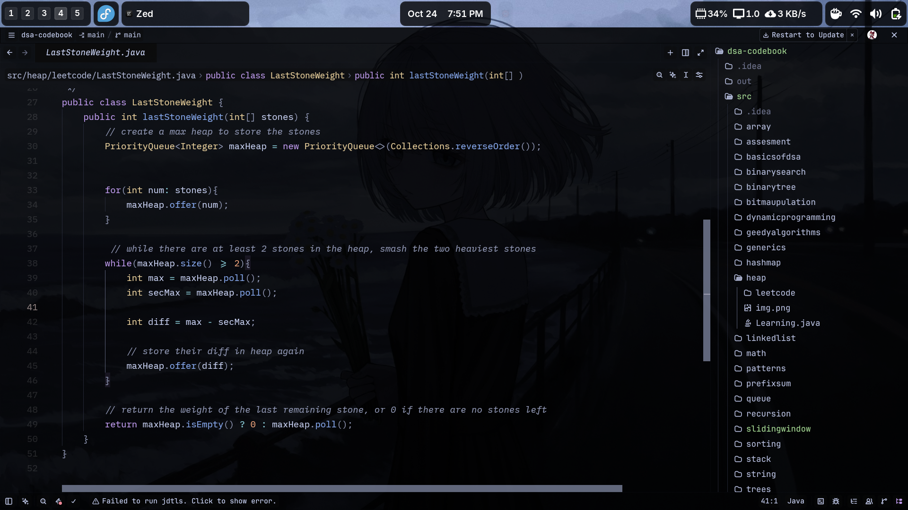

# 🔧 Dotfiles (Fedora)

My personal Fedora + GNOME setup : clean, minimal and tailored to my workflow.

A collection of my configurations, desktop customizations and application settings. Always evolving as my workflow changes.

## ⚙️ Setup

| Component | Details |
|:--|:--|
| **OS** | Fedora Workstation |
| **DE** | GNOME |
| **GTK Theme** | Yaru Dark |
| **Cursor** | Bibata Modern Ice |
| **Terminal** | Ghostty |
| **Shell** | Zsh |
| **Prompt** | Powerlevel10k |
| **Launcher** | Vicinae |
| **Fetch** | Fastfetch |

## 🧩 GNOME Extensions

- ArcMenu
- Blur My Shell
- Caffeine
- Clipboard Indicator
- Dash to Dock
- Just Perfection
- Media Controls
- Tasks in Panel
- Tiling Shell
- User Themes
- Vitals

## 📸 In Action

### 🖥️ Desktop


### 🌊 CAVA


### 🪟 GNOME Overview


### 💻 Ghostty & Terminal


### 📊 Fastfetch


### 🚀 Vicinae Launcher


### 🧠 Obsidian


### 🧑‍💻 Zed Editor


## 📂 What's Inside

```text
.config/          → Application configurations
gnome/            → GNOME extensions config
Obsidian Config/  → Obsidian custom CSS , Theme: (Fusion)
screenshots/      → Desktop and application screenshots
.p10k.zsh         → Powerlevel10k configuration
.bashrc           → Bash configuration
TOP-PANEL         → guide to make panel like mine
```

## 🎨 Want the Same Top Panel?

Check out my [**GNOME Top Panel Customization Guide**](TOP-PANEL.md) for step-by-step instructions and screenshots.


## Restoring GNOME Settings 

The `gnome/` directory contains exported GNOME and extension settings. Install the relevant extensions first, then import their settings using Dconf.

Example — restoring Dash to Dock:

```bash
dconf load /org/gnome/shell/extensions/dash-to-dock/ < gnome/dash-to-dock.ini
```

Back up your existing settings before importing. Compatibility may vary across GNOME and extension versions so keep backup of your configs.


## ⭐ Like This Setup?

If you find these dotfiles useful or take inspiration from them, consider giving the repository a star!
Feel free to explore, adapt and make the setup your own.


Wallpaper Credit - https://x.com/sakiika010513/status/2067596221284503725